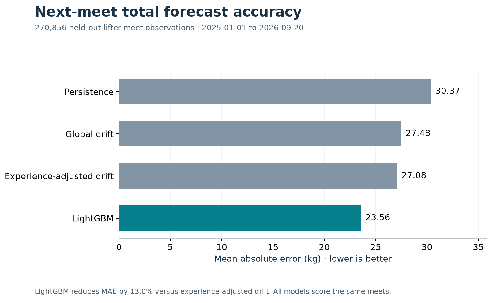
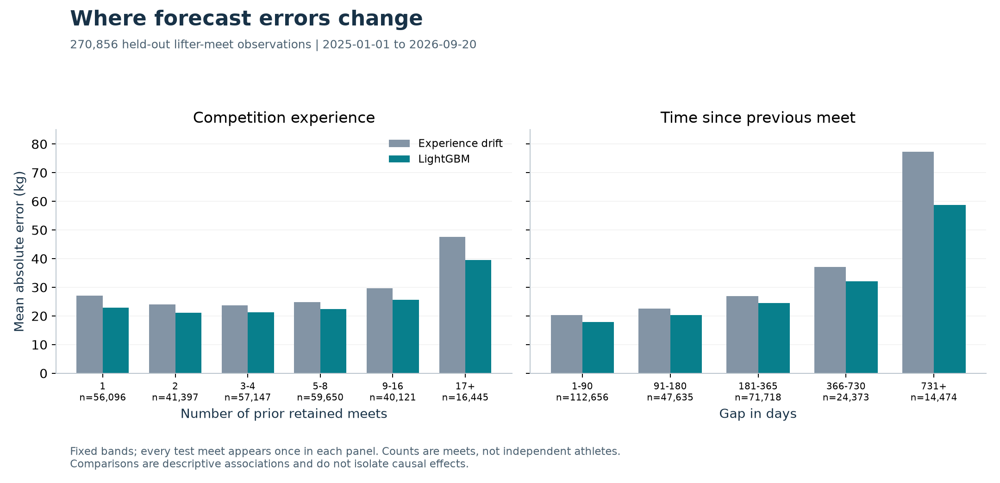

# Powerlifting Strength Forecaster

Forecast the change in a competitive powerlifter's total at their next scheduled meet using prior competition history and entry information. A LightGBM regressor achieves **23.56 kg MAE**, reducing error **13.0% versus experience-adjusted drift** on 270,856 chronologically held-out observations.

**Stack:** Python, pandas, NumPy, LightGBM, scikit-learn, Matplotlib.

## Results

Final test period: **January 1, 2025–September 20, 2026**. All models are evaluated on the same lifter-meet observations after fitting on pre-2025 data.

| Model | MAE (kg) | RMSE (kg) | R² on total |
| --- | ---: | ---: | ---: |
| Previous-total persistence | 30.37 | 53.61 | 0.895 |
| Global drift | 27.48 | 52.15 | 0.901 |
| Experience-adjusted drift | 27.08 | 51.50 | 0.903 |
| **LightGBM delta regression** | **23.56** | **42.53** | **0.934** |

The primary comparison is the **13.0% MAE reduction against experience-adjusted drift**, the strongest validation baseline. Improvement against simple persistence is **22.4%**. MAE measures the average absolute error in kilograms; R² is secondary because previous strength already explains much of next-meet total variation. Unrounded metrics, model settings, and artifact checksums are in the [final evaluation report](reports/final_test.json).



## Prediction task

```text
delta_total = target_total - previous_total
predicted_total = previous_total + predicted_delta
```

The model predicts improvement or regression relative to the previous retained meet. The prediction date and entry context are assumed known before the target result. A lifter needs at least one prior valid full-power result; their first retained appearance supplies history but cannot be a prediction target.

## Dataset and processing

The official [OpenPowerlifting bulk dataset](https://openpowerlifting.gitlab.io/opl-csv/) was downloaded on September 26, 2026. The snapshot contains **4,036,909 results**, 42 columns, and 1,014,126 distinct source names.

1. Retain squat–bench–deadlift (`SBD`) results with finite, positive totals. Individual attempt columns are excluded; nonpositive best-lift values become missing.
2. Resolve duplicate source-name/date records. Exclude an entire day when nonmissing sex, equipment, meet country, total, or best-lift values conflict. Otherwise select the most complete original row, with deterministic ties.
3. Sort the remaining **2,568,978 lifter-date records** into histories and remove first appearances from the target rows. This yields **1,780,795 prediction observations** across 429,182 source names with repeat appearances.

Counts are measured from this snapshot. [Inspection](reports/data_inspection.json), [cleaning](reports/initial_cleaning.json), [deduplication](reports/deduplication.json), and [feature](reports/features.json) reports document the transformations.

## Features and leakage prevention

The model uses 15 predictors:

| Group | Predictors |
| --- | --- |
| Historical strength | Previous total, squat, bench, and deadlift; historical best total; mean of up to three previous totals |
| Experience and timing | Prior retained meet count; days since first and previous retained meets; mean gap between completed prior meets |
| Athlete and entry context | Age estimated from a previously reported age; sex; equipment; federation; tested category |

Performance features are shifted within each lifter before computing historical summaries. The target total, current lifts, bodyweight, placing, and strength scores are excluded from the predictor allowlist. Age uses only an earlier reported age plus elapsed time. Sex, equipment, federation, and tested category use result metadata as a proxy for entry information available beforehand. Missing numeric features remain missing; categorical levels are fitted on training data, with unseen levels treated as missing.

Tests perturb current and future outcomes, truncate histories, check chronological boundaries, and verify that held-out outcomes cannot affect fitted parameters or predictions. See [history tests](tests/test_histories.py), [feature tests](tests/test_features.py), and [final evaluation tests](tests/test_final_evaluation.py).

## Baselines, model, and validation

Baselines predict the previous total plus either zero, the training-wide mean change, or the mean change for an experience band: **1, 2, 3–4, 5–8, 9–16, or 17+ prior meets**. An unseen band falls back to the global mean.

| Split | Target-meet dates | Observations |
| --- | --- | ---: |
| Training | Before 2023 | 1,213,356 |
| Validation | 2023–2024 | 296,583 |
| Final test | 2025–September 20, 2026 | 270,856 |

LightGBM predicts the delta using absolute-error loss and native categorical features. Four fixed configurations vary leaf count and regularization, with a 1,000-tree cap and 50-round early stopping on validation MAE. Validation selected **341 trees, 127 leaves, a minimum of 300 observations per leaf, and L2 regularization of 10**. The [tuning report](reports/lightgbm_tuning.json) records every candidate.

Features, settings, and tree count were frozen before final evaluation. The selected model and all baselines were refitted on the **1,509,939 training-plus-validation observations**, without test-driven early stopping. These are sequential next-meet forecasts: earlier test-period results can inform later meets' histories, while model parameters stay fixed. Lifters may appear in more than one period.

### Yearly robustness

For each historical evaluation year, selection uses only the preceding year; the selected model is then refitted on all earlier observations. These checks use only the original pre-2023 training file.

| Evaluation year | Baseline MAE (kg) | LightGBM MAE (kg) | MAE reduction |
| --- | ---: | ---: | ---: |
| 2020 | 28.20 | 24.25 | 14.0% |
| 2021 | 30.07 | 26.22 | 12.8% |
| 2022 | 27.04 | 23.17 | 14.3% |

LightGBM improves on experience-adjusted drift in all three years. The pooled reduction is **13.7% across 267,669 observations**. [Walk-forward report](reports/walk_forward.json).

## Error analysis and interpretation

- Test MAE increases from **17.96 kg** for gaps of 1–90 days to **58.67 kg** for gaps of 731+ days. LightGBM still improves on experience-adjusted drift in every gap and experience band examined.
- **72.7%** of test predictions are within 25 kg; median absolute error is **13.55 kg**, and the 90th percentile is **49.77 kg**.
- Permutation analysis uses a fixed sample of 20,000 test observations and three shuffles per feature. Recent average total, previous total, and previous squat/deadlift results produce the largest increases in delta MAE when shuffled.

These are descriptive findings from the frozen model. Permutation effects are not causal or additive: correlated predictors and implausible shuffled combinations affect interpretation. Repeat standard deviations are not confidence intervals. The [analysis report](reports/analysis.json) records counts, signed bias, error quantiles, and all permutation results.



Additional figures: [training progression by experience](reports/figures/training_progression.png) and [permutation importance](reports/figures/permutation_importance.png).

## Limitations

- Source names, including disambiguation suffixes, are imperfect athlete identifiers; collisions or name changes can merge or split histories.
- The cohort contains repeat competitors with valid positive full-power totals. It excludes first appearances, partial events, unsuccessful totals, and conflicting same-day records; results do not describe those populations.
- Meet dates and entry categories are assumed available at prediction time. Reported age is approximate, and tested category indicates an entry category, not an individual drug-test result.
- Repeated observations share athletes, and earlier outcomes within an evaluation period remain available as history. This is not an evaluation restricted to completely unseen athletes or a fixed-origin multi-meet forecast.
- The retrospective snapshot includes subsequent data corrections; historical publication delays are not modeled. Injury, training, and preparation data are unavailable. Group differences are not causal effects, and no prediction intervals are provided.

## Reproduction

See the [reproduction guide](docs/reproduction.md) for environment setup, the snapshot checksum, the full command sequence, and artifact locations. Python 3.13 was used; dependencies are pinned in [pyproject.toml](pyproject.toml). The downloader retrieves a changing latest archive, so exact reproduction requires the recorded snapshot. Dataset files, fitted models, and row-level predictions are excluded from Git; aggregate reports and figures are included.

The implementation is organized in [src/powerlifting_forecaster](src/powerlifting_forecaster), with **51 tests** in [tests](tests). Data are supplied by the [OpenPowerlifting project](https://www.openpowerlifting.org/); see its [data service and attribution information](https://openpowerlifting.gitlab.io/opl-csv/).
